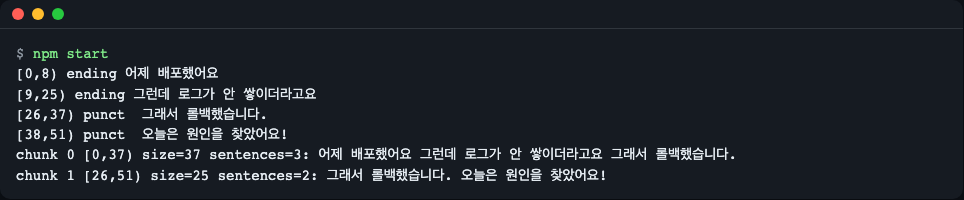
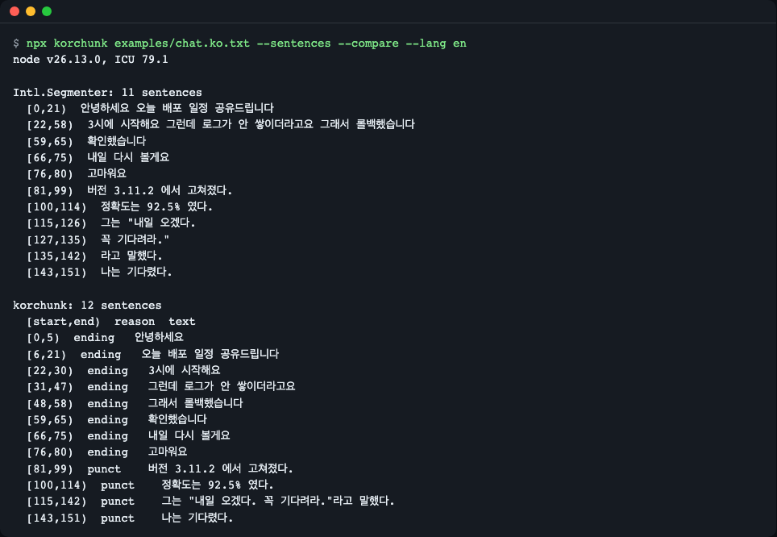
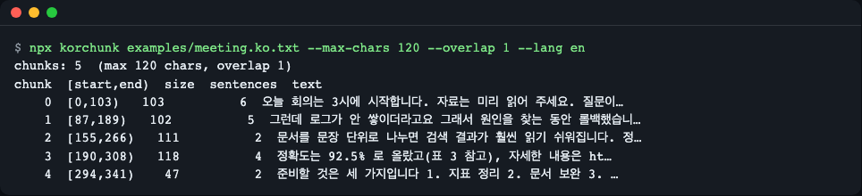
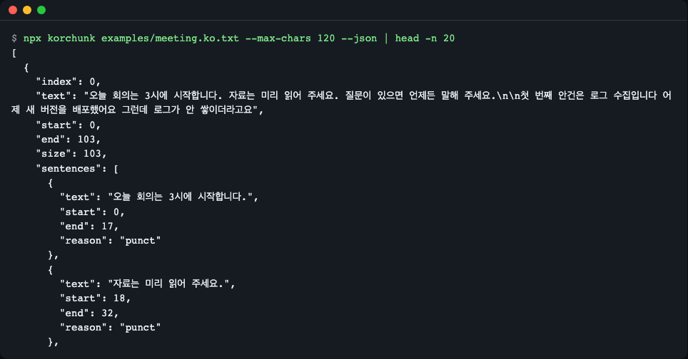
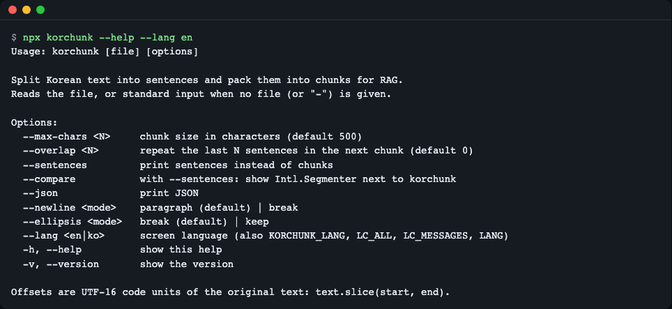
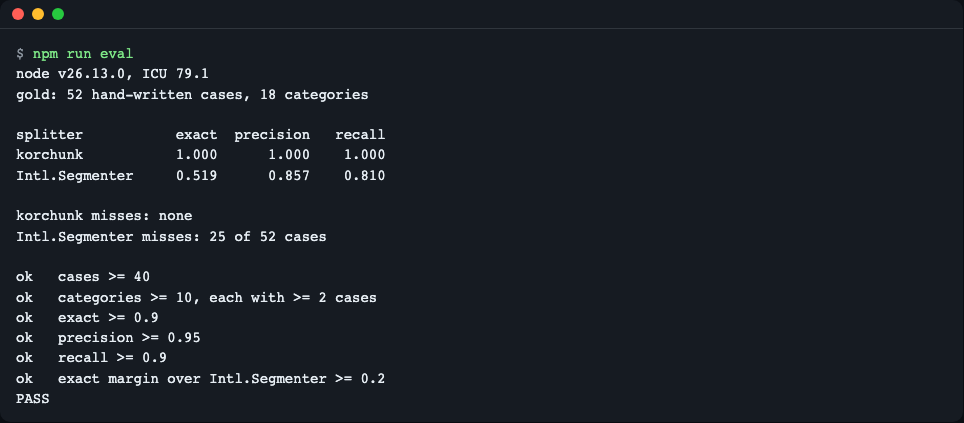

# korchunk

[한국어](README.md) | **English**

A rule-based Korean sentence splitter and sentence-aware chunker for RAG indexing, written in TypeScript with zero runtime dependencies. It also splits text without periods ("…했어요 그런데 …", meeting notes, chat, dictation), packs sentences into chunks within a character or token budget, and returns UTF-16 `[start, end)` offsets into the original text for every sentence and chunk.



*`npm start`. Even period-less spoken Korean is split into sentences, and every chunk carries original-text offsets.*

## Install

```bash
npm install github:LeeGyeongPil/korchunk
```

- Node 20.19 or newer (ESM only; CommonJS works through `require()` of ES modules on Node 20.19+ / 22.12+). The code is plain JavaScript and also runs in browsers and Deno.
- Zero runtime dependencies. The only dev dependency is `typescript`.
- No Node yet? `brew install node` (macOS) or download it from [nodejs.org](https://nodejs.org/).
- To try the repository itself:

```bash
git clone https://github.com/LeeGyeongPil/korchunk
cd korchunk
npm install && npm start
```

## Quick start

```js
import { splitSentences, chunk } from "korchunk";

const text = "어제 배포했어요 그런데 로그가 안 쌓이더라고요 그래서 롤백했습니다. 오늘은 원인을 찾았어요!";

for (const s of splitSentences(text)) {
  console.log(`[${s.start},${s.end}) ${s.reason.padEnd(6)} ${s.text}`);
}
for (const c of chunk(text, { maxChars: 40, overlapSentences: 1 })) {
  console.log(`chunk ${c.index} [${c.start},${c.end}) size=${c.size} sentences=${c.sentences.length}: ${c.text}`);
}
```

```text
[0,8) ending 어제 배포했어요
[9,25) ending 그런데 로그가 안 쌓이더라고요
[26,37) punct  그래서 롤백했습니다.
[38,51) punct  오늘은 원인을 찾았어요!
chunk 0 [0,37) size=37 sentences=3: 어제 배포했어요 그런데 로그가 안 쌓이더라고요 그래서 롤백했습니다.
chunk 1 [26,51) size=25 sentences=2: 그래서 롤백했습니다. 오늘은 원인을 찾았어요!
```

This is the same code as [`examples/quickstart.mjs`](examples/quickstart.mjs) and runs with `npm start`. `chunk 1` starts at `[26,51)` because `overlapSentences: 1` repeats the last sentence of the previous chunk. (The Korean sample text is the input; it reads "Deployed yesterday / but logs were not piling up / so we rolled back. Found the cause today!")

## Core concepts

1. **Three boundary cues** — sentence punctuation (`. ? ! …`), sentence-final endings (`-습니다`, `-어요`, `-죠`, `-했다`, ...), and line breaks. Each sentence's `reason` tells which cue ended it (`punct` / `ending` / `newline` / `end`).
2. **Exceptions that block a boundary** — decimals and versions (`3.11.2`), list numbers (`1.`), URLs and e-mail addresses, dates, abbreviations, matched quotes and brackets, and the quotation particle after a closing quote (`라고`, `하고`). You can also pass `protect` patterns.
3. **Sentence-level chunking** — sentences are packed greedily up to the budget (characters or tokens). A chunk never starts mid-sentence, and overlap (`overlapSentences`) is counted in sentences. A sentence longer than the budget is cut at a clause, then a space, then a character.
4. **Original-text offsets** — every result is `[start, end)` into the original string and `original.slice(start, end) === text`.


- Decisions are made on a normalized (NFC) copy, and offsets are mapped back to the original through an index table. NFD input (decomposed Hangul, e.g. macOS file names) is split by the same rules with exact offsets.
- **Offsets are UTF-16 code units** (the same unit as JavaScript `String.prototype.slice` and the `index` of `Intl.Segmenter`). An emoji counts as 2, and NFD Hangul is longer than NFC. This differs from Python's code point offsets.

## API

| Name | What it does | Main arguments | Returns |
|---|---|---|---|
| `splitSentences(text, options?)` | Splits into sentences | `newline`: `"paragraph"` (default) / `"break"`, `ellipsis`: `"break"` (default) / `"keep"`, `endings`: `"default"` / `"punct-only"`, `abbreviations: string[]`, `protect: RegExp[]` | `Sentence[]` |
| `chunk(text, options)` | Packs sentences into chunks | `maxChars` or `maxTokens` + `countTokens` (exactly one budget), `overlapSentences` (default 0), plus all `splitSentences` options | `Chunk[]` |
| `KorchunkOptionError` | Invalid-option error (extends `RangeError`). Unknown option keys such as the typo `overlap` are also rejected with `E_OPTION` and a suggested name | `code`: `E_BUDGET_MISSING`, `E_BUDGET_BOTH`, `E_BUDGET_RANGE`, `E_COUNT_TOKENS`, `E_OVERLAP`, `E_OPTION` | — |
| `version` | Package version string | — | `string` |
| Types | `Sentence` `{text,start,end,reason}`, `Chunk` `{index,text,start,end,size,sentences,split?}`, `SplitOptions`, `ChunkOptions`, `BoundaryReason`, `KorchunkErrorCode` | | |

- `Chunk.text` is always `original.slice(start, end)`, so whitespace and line breaks between sentences are kept and count toward the budget.
- `Chunk.split` exists only when a too-long sentence was cut: `"clause"`, `"space"` or `"hard"` (characters). Surrogate pairs (emoji) and combining marks are never split.
- `countTokens` must be synchronous and monotonic (longer text never counts fewer tokens).

## Usage examples

> Examples 1-4 below are each self-contained (imports included): copy one into an `.mjs` file and run it. Example 1 also exists as `examples/tokens.mjs`.

**1) Token budget** — [`examples/tokens.mjs`](examples/tokens.mjs). korchunk bundles no tokenizer; you pass your own. This one is a toy counter (1 token per 2 characters); the file's comments show how to plug in `js-tiktoken`.

```js
import { chunk } from "korchunk";

const text = "회의 시작할게요 자료 공유해 주세요 오늘 안건은 세 가지입니다. 첫째는 로그 수집이에요. 둘째는 검색 품질입니다.";
const countTokens = (s) => Math.ceil(s.length / 2);
for (const c of chunk(text, { maxTokens: 14, countTokens })) {
  console.log(`chunk ${c.index} tokens=${c.size}: ${c.text}`);
}
```

```text
chunk 0 tokens=10: 회의 시작할게요 자료 공유해 주세요
chunk 1 tokens=8: 오늘 안건은 세 가지입니다.
chunk 2 tokens=14: 첫째는 로그 수집이에요. 둘째는 검색 품질입니다.
```

**2) Find the original position** — `slice` stays correct even with an emoji.

```js
import { splitSentences } from "korchunk";

const text = "정확도는 92.5% 로 올랐어요. 자세한 내용은 https://a.b/c 를 보세요 감사합니다 👍 또 봬요!";
for (const s of splitSentences(text)) console.log(s.start, s.end, s.reason, JSON.stringify(text.slice(s.start, s.end)));
```

```text
0 18 punct "정확도는 92.5% 로 올랐어요."
19 46 ending "자세한 내용은 https://a.b/c 를 보세요"
47 55 ending "감사합니다 👍"
56 61 punct "또 봬요!"
```

**3) Ellipsis and protected spans** — by default `...` followed by a space ends a sentence. Use `ellipsis: "keep"` for hesitating ellipses, and `protect` for spans that must never be cut.

```js
import { splitSentences } from "korchunk";

const t = "글쎄요... 잘 모르겠어요. 다시 볼게요.";
console.log(splitSentences(t).length);                       // 3
console.log(splitSentences(t, { ellipsis: "keep" }).length); // 2
console.log(
  splitSentences("주문번호 AB-123 은 처리됐어요 다음 건은 대기합니다", { protect: [/AB-123 은/g] })
    .map((s) => s.text),
);
// [ '주문번호 AB-123 은 처리됐어요', '다음 건은 대기합니다' ]
```

**4) Invalid options** — check `code` on `KorchunkOptionError`.

```js
import { chunk } from "korchunk";

const text = "회의 시작할게요 자료 공유해 주세요.";
try { chunk(text, {}); } catch (e) { console.log(e instanceof RangeError, e.name, e.code); }
// true KorchunkOptionError E_BUDGET_MISSING
```

**5) CommonJS** — `const { splitSentences, chunk } = require("korchunk");` (checked on Node 26: the exports are `KorchunkOptionError`, `chunk`, `splitSentences`, `version`.)

## CLI

A thin tool for looking at the library's result right away. With no file argument, or `-`, it reads standard input.

```bash
npx korchunk examples/chat.ko.txt --sentences --compare
npx korchunk examples/meeting.ko.txt --max-chars 120 --overlap 1
npx korchunk examples/meeting.ko.txt --max-chars 120 --json
```

`examples/*.txt` exist **only in a cloned repo** (they are not part of the npm or GitHub install). If you only installed the package, pass any text file path or use standard input:

```bash
echo "어제 배포했어요 그런데 로그가 안 쌓이더라고요. 오늘은 찾았어요!" | npx korchunk --sentences
```

```text
sentences: 3
[start,end)  reason  text
[0,8)  ending   어제 배포했어요
[9,26)  punct    그런데 로그가 안 쌓이더라고요.
[27,36)  punct    오늘은 찾았어요!
```

| Option | Meaning |
|---|---|
| `--max-chars <N>` | chunk size in characters (default 500) |
| `--overlap <N>` | repeat the last N sentences in the next chunk (default 0) |
| `--sentences` | print sentences instead of chunks |
| `--compare` | with `--sentences`: show `Intl.Segmenter` next to korchunk |
| `--json` | print JSON |
| `--newline paragraph\|break` | line break handling (default paragraph) |
| `--ellipsis break\|keep` | ellipsis handling (default break) |
| `--lang en\|ko` | screen language. Order: `--lang` > `KORCHUNK_LANG` > `LC_ALL` > `LC_MESSAGES` > `LANG` (Korean if it starts with `ko`, otherwise English) |
| `-h`, `--help` / `-v`, `--version` | help / version |

Exit codes: 0 success, 1 input error (file missing or unreadable), 2 usage error (an unknown option also prints a `korchunk --help` hint). If the input is empty or only whitespace, a warning "The input is empty or only whitespace" goes to standard error and an empty result is printed with exit code 0.



*`--compare`: the same chat text split by `Intl.Segmenter` (top) and korchunk (bottom). The first line prints this machine's Node and ICU versions, because the `Intl.Segmenter` result can vary with the ICU version.*



*The chunk table. An overlapped sentence appears again at the start of the next chunk.*



*`--json`: JSON for your pipeline (`start`, `end` and `reason` per sentence).*



*`--help` in English. `--lang ko` prints the Korean screen.*

## How it splits

- **Sentence-final endings** use a table with the rule "never a bare `다`": `-니다`, `-ㅂ니까`, `-요` (nouns such as 중요·필요 excluded), `-죠`, a final consonant `ㅆ/ㄴ/ㅄ` + `다` (했다·한다·없다), `이다`, `-잖아`, `-거야`, `-구나`, and so on. Connective endings such as `-는데`, `-지만`, `-면서` are not boundaries.
- **Suppression** — `ㅋㅋ`, `ㅎㅎ` and `~` are stripped before the ending check, a word that closes a bracket is not treated as an ending, and quotes and brackets are paired within a paragraph (up to 1000 characters) so nothing is cut inside them. Pairing resets at paragraph and line boundaries so an unmatched quote cannot swallow the whole document.
- **Line breaks** — `newline: "paragraph"` (default) forces a boundary only at blank lines; `"break"` splits at every line break.
- `endings: "punct-only"` turns the ending rules off and uses punctuation and line breaks only.

## Accuracy

`npm run eval` compares against `Intl.Segmenter` on a hand-written gold corpus (52 cases, 18 categories).

```text
node v26.13.0, ICU 79.1
gold: 52 hand-written cases, 18 categories

splitter           exact  precision   recall
korchunk           1.000      1.000    1.000
Intl.Segmenter     0.519      0.857    0.810

korchunk misses: none
Intl.Segmenter misses: 25 of 52 cases
```



*`npm run eval`.*

**Caution: these numbers are not a generalization accuracy.** The gold corpus was written by the same person who wrote the rules. The rules were not tuned to the corpus, but it is not an independent evaluation, so real documents may score lower. `Intl.Segmenter` is a punctuation-based splitter that knows no Korean endings, so period-less text is a hard case for it. Validation on external data is future work.

For reference, in a probe I ran myself during planning (10 tricky Korean cases with hand-marked sentence counts), the number of cases matching the expected count was 6 for `Intl.Segmenter`, 6 for sentence-splitter and 5 for sentencex. They diverged on period-less colloquial text, list numbers and periods inside quotes (run directly on 2026-11-12, Node v26.13.0; package versions are in the [Alternatives](#alternatives) table below). The probe inputs are not included in the repo, so readers cannot reproduce it exactly.

## Limitations

- **Rule-based, no morphological analysis.** A plain adjective statement without a final-consonant clue is not split unless punctuation follows. Example: `오늘 날씨가 좋다 그래서 산책을 했다` stays one sentence.
- The ending table is conservative, so something like `이 책은 정말 재미있다 추천한다` is only partly split. If precision matters most, [kss](https://github.com/hyunwoongko/kss) (Python, morphological backends) is a better fit.
- A single code point larger than the budget (e.g. an emoji with `maxChars: 1`) is emitted over budget to guarantee progress.
- Quote and bracket pairing is per paragraph and limited to 1000 characters; an unmatched straight quote can shift pairing within its paragraph.
- Whether an ellipsis ends a sentence is a judgement call that differs between tools, so it is exposed as the `ellipsis` option.
- The library reads no files and uses no network; it only processes the input string. It is built to be linear in input length (a performance test splits and chunks 400k characters of whitespace-free `1.` repeats and long URLs in under 2 seconds; here, chunking 200k repeats of `"1."` took about 17 ms), but the cost of an untrusted regular expression passed to `protect` is the caller's responsibility.

## When to use it

- Good fit: you index Korean documents for RAG in Node, a browser or an edge runtime without running a separate Python service, and you need chunks that never start mid-sentence plus original-text offsets.
- Other tools: morphology-level splitting precision → [kss](https://github.com/hyunwoongko/kss) (Python); plain punctuated text with no dependency → the built-in [`Intl.Segmenter`](https://developer.mozilla.org/docs/Web/JavaScript/Reference/Global_Objects/Intl/Segmenter); English/Japanese-oriented sentence splitting → [sentence-splitter](https://github.com/textlint-rule/sentence-splitter); character or separator based splitting without sentence awareness → [@langchain/textsplitters](https://www.npmjs.com/package/@langchain/textsplitters) or [llm-splitter](https://github.com/nearform/llm-splitter); light sentence-only splitting of punctuated Korean text → [kr-sentence](https://www.npmjs.com/package/kr-sentence).
- Features of those tools change, so check their official docs before choosing (as of 2026-11-14 the punctuation-based Korean splitter [kr-sentence](https://www.npmjs.com/package/kr-sentence) exists on npm, but it has no ending-aware splitting, offsets or chunking). The Python project `kochunk` is unrelated despite the similar name.

## Alternatives

Values checked on 2026-11-12 from each package registry or repository. Features change, so check the official docs before choosing.

| Tool | Form / version | Korean ending awareness | Offsets | Chunking | Runtime / dependencies |
|---|---|---|---|---|---|
| **korchunk** | npm (GitHub install) 0.1.2 | yes (rule-based) | UTF-16 `[start,end)` | sentence-based, overlap | zero dependencies, sync |
| [`Intl.Segmenter`](https://developer.mozilla.org/docs/Web/JavaScript/Reference/Global_Objects/Intl/Segmenter) | built into JS | no (punctuation-based) | `index` | none | built in; results vary with ICU version |
| [sentence-splitter](https://www.npmjs.com/package/sentence-splitter) | npm 5.0.3 | no (aimed at English/Japanese) | `range`/`loc` | none | npm |
| [sentencex-wasm](https://www.npmjs.com/package/sentencex-wasm) | npm 0.1.34 | no (punctuation + per-language abbreviations) | boundary function | none | WASM init required |
| [llm-splitter](https://github.com/nearform/llm-splitter) | npm 0.3.0 | no (you supply the splitter) | `start`/`end` | characters / paragraphs | npm |
| [@langchain/textsplitters](https://www.npmjs.com/package/@langchain/textsplitters) | npm 1.0.2 | no (recursive separators) | none | yes (not sentence-aware) | needs `@langchain/core` |
| [kss](https://github.com/hyunwoongko/kss) | Python 6.0.6 | yes (morphological backends) | none | none | Python, backend install |

Cases matching the expected count in the 10-case probe: `Intl.Segmenter` 6, sentence-splitter 6, sentencex 5 (a probe I ran myself on 2026-11-12; the inputs are not in the repo, and these are not figures from the linked pages). Cutting the same 322 characters at 60 characters, llm-splitter split 5 of 6 chunks mid-sentence and LangChain `RecursiveCharacterTextSplitter` split 3 of 7.

## Roadmap

These are plans, not promises of dates.

- **v0.2** — a LangChain.js adapter under the `korchunk/langchain` subpath (extends `@langchain/textsplitters`, offsets in document metadata) and Markdown structure (`structure: "markdown"`: keep headings, code blocks and tables). The core keeps zero dependencies (the adapter is an optional peer).
- **v0.3** — user ending/exception dictionary, per-boundary rule IDs, short-sentence merging (`minChars`), and a gold corpus of 80+ cases.

## Troubleshooting

| Symptom | Cause | Fix |
|---|---|---|
| `Cannot find module 'korchunk'` / `require` error | Node older than 20.19 | Upgrade to Node 20.19+ (the package is ESM only) |
| `slice` by offset is shifted after an emoji | Mixed with a tool that counts code points | Offsets are UTF-16 code units; use them directly with `String.prototype.slice` |
| `KorchunkOptionError: E_COUNT_TOKENS` | `maxTokens` given without `countTokens` | Pass a synchronous counter (e.g. from `js-tiktoken`) |
| `E_BUDGET_BOTH` / `E_BUDGET_MISSING` | Both `maxChars` and `maxTokens`, or neither | Specify exactly one |
| `E_OPTION: Unknown option "overlap"` | Option name typo | Use the suggested name (`overlapSentences`) |
| CLI prints "The input is empty or only whitespace" | The file or standard input is empty or whitespace only | Check the input path (exit code stays 0) |
| `Cannot find module '…/node_modules/korchunk/dist/index.js'` (import) or the CLI's `korchunk is not built` (Korean screen: `korchunk 가 빌드되지 않았습니다`) | A GitHub install builds `dist/` with the `prepare` (tsc) script, and npm skipped it (`--ignore-scripts`, `ignore-scripts=true` in `.npmrc`, or `allowScripts` set to false) | Reinstall without a setting that blocks install scripts: `npm uninstall korchunk && npm install github:LeeGyeongPil/korchunk`. In a cloned repo, run `npm run build` |
| `--compare` differs from another machine | `Intl.Segmenter` varies with the ICU version | Record the Node and ICU versions printed on the first line |

## Versioning and compatibility

- Follows Semantic Versioning. While the version is 0.x, minor releases may change the API; changes are listed in [CHANGELOG.md](CHANGELOG.md).

## Development and contributing

```bash
npm install
npm test          # type build + unit tests (scripts/test.mjs finds test/*.test.mjs; works on Node 20.19)
npm run eval      # gold corpus evaluation
npm run smoke     # package contents and ESM/CJS load check
```

## License

MIT. See [LICENSE](LICENSE).
