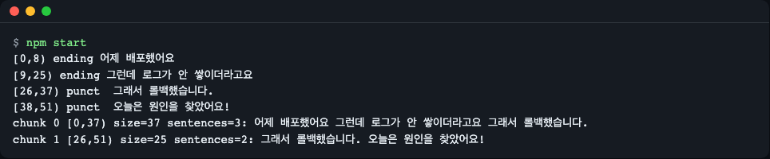
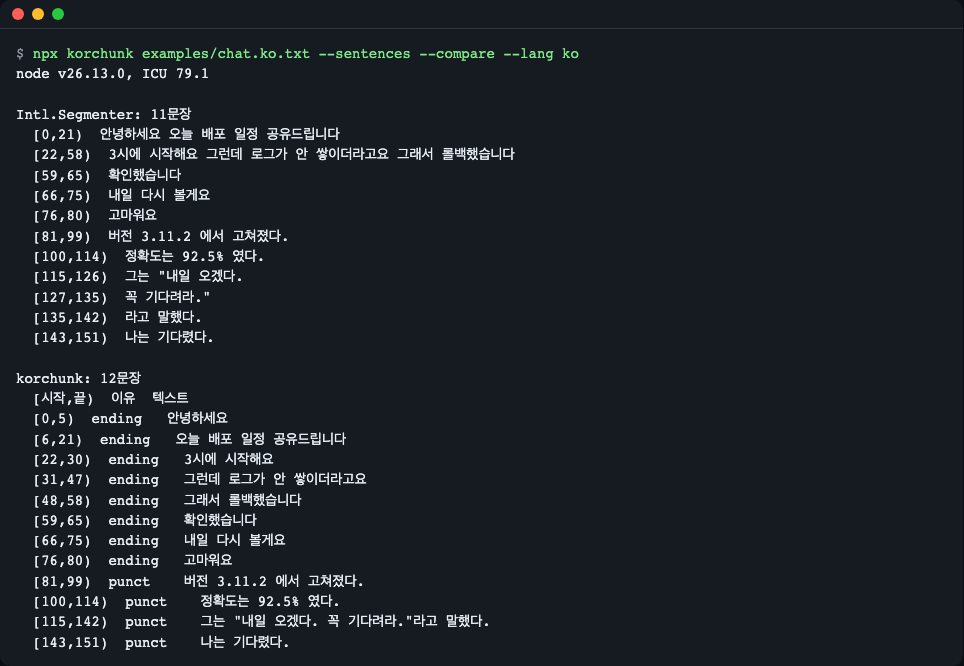
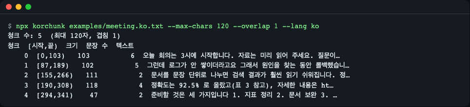
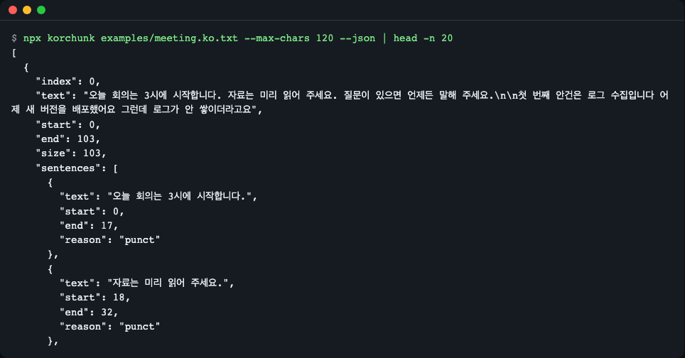
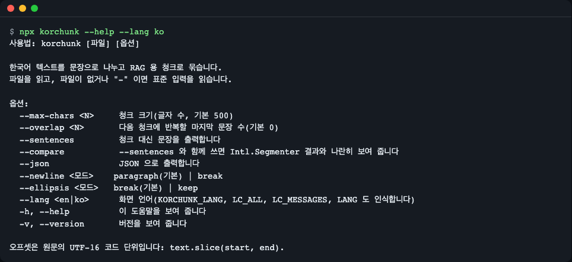
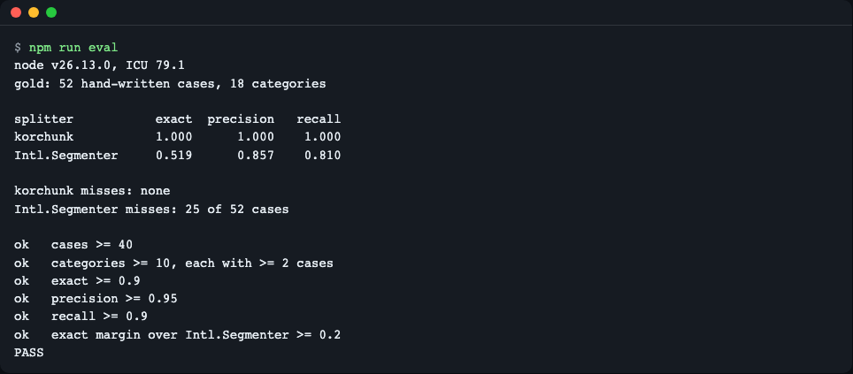

# korchunk

**한국어** | [English](README.en.md)

> **English summary** — A rule-based Korean sentence splitter and sentence-aware chunker for RAG indexing, written in TypeScript. It also splits text that has no periods ("…했어요 그런데 …"), and every sentence and chunk carries UTF-16 `[start, end)` offsets into the original text. Zero runtime dependencies; install with `npm install github:LeeGyeongPil/korchunk`.

한국어 문서를 RAG 색인용으로 문장 단위로 자르고, 글자·토큰 예산 안에서 문장 단위 청크로 묶어 원문 오프셋까지 돌려주는 의존성 0 TypeScript 라이브러리입니다.



*`npm start` 실행 화면. 마침표 없는 구어체까지 문장으로 나뉘고, 청크마다 원문 오프셋이 붙습니다.*

## 설치

```bash
npm install github:LeeGyeongPil/korchunk
```

- Node 20.19 이상(ESM 전용이며, CommonJS 는 `require()` 의 ESM 로드를 지원하는 Node 20.19+ / 22.12+ 에서 쓸 수 있습니다). 브라우저·Deno 에서도 동작하는 순수 코드입니다.
- 런타임 의존성 0개. 개발 의존성은 `typescript` 하나입니다.
- Node 가 없다면 `brew install node`(macOS) 또는 [nodejs.org](https://nodejs.org/) 에서 설치하세요.
- 레포를 직접 받아 써 보려면:

```bash
git clone https://github.com/LeeGyeongPil/korchunk
cd korchunk
npm install && npm start
```

## 빠르게 시작하기

```js
import { splitSentences, chunk } from "korchunk";

const text = "어제 배포했어요 그런데 로그가 안 쌓이더라고요 그래서 롤백했습니다. 오늘은 원인을 찾았어요!";

for (const s of splitSentences(text)) {
  console.log(`[${s.start},${s.end}) ${s.reason.padEnd(6)} ${s.text}`);
}
for (const c of chunk(text, { maxChars: 40, overlapSentences: 1 })) {
  console.log(`chunk ${c.index} [${c.start},${c.end}) size=${c.size} sentences=${c.sentences.length}: ${c.text}`);
}
```

```text
[0,8) ending 어제 배포했어요
[9,25) ending 그런데 로그가 안 쌓이더라고요
[26,37) punct  그래서 롤백했습니다.
[38,51) punct  오늘은 원인을 찾았어요!
chunk 0 [0,37) size=37 sentences=3: 어제 배포했어요 그런데 로그가 안 쌓이더라고요 그래서 롤백했습니다.
chunk 1 [26,51) size=25 sentences=2: 그래서 롤백했습니다. 오늘은 원인을 찾았어요!
```

이 코드는 레포의 [`examples/quickstart.mjs`](examples/quickstart.mjs) 와 같고 `npm start` 로 실행됩니다. `chunk 1` 이 `[26,51)` 에서 시작하는 것은 `overlapSentences: 1` 때문에 앞 청크의 마지막 문장이 다시 들어갔기 때문입니다.

## 핵심 개념

1. **문장 경계 단서 3가지** — 문장부호(`. ? ! …`), 종결어미(`-습니다`, `-어요`, `-죠`, `-했다` 등), 줄바꿈. 각 문장의 `reason` 이 어느 단서로 끊겼는지 알려 줍니다(`punct` / `ending` / `newline` / `end`).
2. **경계를 막는 예외** — 소수점·버전(`3.11.2`), 목록 번호(`1.`), URL·이메일, 날짜, 약어, 짝이 맞는 따옴표·괄호 안, 닫는 따옴표 뒤 인용 조사(`라고`·`하고`). `protect` 로 직접 지정할 수도 있습니다.
3. **문장 단위 청킹** — 문장을 예산(글자 수 또는 토큰 수)까지 탐욕적으로 이어 붙입니다. 문장 중간에서 끊기지 않고, 겹침(`overlapSentences`)도 문장 단위입니다. 문장 하나가 예산보다 길면 절 → 공백 → 글자 순으로 쪼갭니다.
4. **원문 오프셋** — 모든 결과는 원문 기준 `[start, end)` 이고 `원문.slice(start, end) === text` 입니다.


- 판정은 정규화(NFC)한 사본에서 하고, 결과 오프셋은 인덱스 표로 원문 기준으로 되돌립니다. 그래서 macOS 파일명처럼 자모가 풀린(NFD) 입력도 같은 규칙으로 잘리고 오프셋은 정확합니다.
- **오프셋 단위는 UTF-16 코드 단위**입니다(JavaScript `String.prototype.slice`·`Intl.Segmenter` 의 `index` 와 같음). 이모지는 2, NFD 한글은 NFC 보다 깁니다. Python 의 코드 포인트 오프셋과 다릅니다.

## API

| 이름 | 하는 일 | 주요 인자 | 반환 |
|---|---|---|---|
| `splitSentences(text, options?)` | 문장으로 자름 | `newline`: `"paragraph"`(기본)·`"break"`, `ellipsis`: `"break"`(기본)·`"keep"`, `endings`: `"default"`·`"punct-only"`, `abbreviations: string[]`, `protect: RegExp[]` | `Sentence[]` |
| `chunk(text, options)` | 문장 단위 청크로 묶음 | `maxChars` 또는 `maxTokens`+`countTokens`(둘 중 하나만), `overlapSentences`(기본 0), `splitSentences` 옵션 전부 | `Chunk[]` |
| `KorchunkOptionError` | 잘못된 옵션 오류(`RangeError` 상속). 알 수 없는 옵션 키(오타 `overlap` 등)도 `E_OPTION` 으로 거부하고 비슷한 이름을 제안합니다 | `code`: `E_BUDGET_MISSING` · `E_BUDGET_BOTH` · `E_BUDGET_RANGE` · `E_COUNT_TOKENS` · `E_OVERLAP` · `E_OPTION` | — |
| `version` | 패키지 버전 문자열 | — | `string` |
| 타입 | `Sentence` `{text,start,end,reason}`, `Chunk` `{index,text,start,end,size,sentences,split?}`, `SplitOptions`, `ChunkOptions`, `BoundaryReason`, `KorchunkErrorCode` | | |

- `Chunk.text` 는 항상 `원문.slice(start, end)` 라서 문장 사이 공백·줄바꿈이 그대로 남고, 그 길이도 예산에 포함됩니다.
- `Chunk.split` 은 예산보다 긴 문장을 쪼갰을 때만 있고 `"clause"`(절) / `"space"`(공백) / `"hard"`(글자)입니다. 서로게이트 쌍(이모지)과 결합 문자 앞에서는 자르지 않습니다.
- `countTokens` 는 동기 함수여야 하고 단조 증가(긴 글이 토큰이 더 적지 않음)여야 합니다.

## 사용 예

> 아래 예 2~4 는 같은 파일 위쪽 `import { splitSentences, chunk } from "korchunk";` 한 줄을 이어서 쓴다고 가정합니다. 각 예는 `examples/` 의 파일로도 있어 그대로 실행할 수 있습니다.

**1) 토큰 예산으로 묶기** — [`examples/tokens.mjs`](examples/tokens.mjs). 토크나이저는 포함하지 않으니 직접 연결합니다. 아래는 2글자를 1토큰으로 세는 장난감 계수기이고, 주석에 `js-tiktoken` 연결 예가 있습니다.

```js
import { chunk } from "korchunk";

const text = "회의 시작할게요 자료 공유해 주세요 오늘 안건은 세 가지입니다. 첫째는 로그 수집이에요. 둘째는 검색 품질입니다.";
const countTokens = (s) => Math.ceil(s.length / 2);
for (const c of chunk(text, { maxTokens: 14, countTokens })) {
  console.log(`chunk ${c.index} tokens=${c.size}: ${c.text}`);
}
```

```text
chunk 0 tokens=10: 회의 시작할게요 자료 공유해 주세요
chunk 1 tokens=8: 오늘 안건은 세 가지입니다.
chunk 2 tokens=14: 첫째는 로그 수집이에요. 둘째는 검색 품질입니다.
```

**2) 오프셋으로 원문 위치 되짚기** — 이모지가 있어도 `slice` 가 그대로 맞습니다.

```js
const text = "정확도는 92.5% 로 올랐어요. 자세한 내용은 https://a.b/c 를 보세요 감사합니다 👍 또 봬요!";
for (const s of splitSentences(text)) console.log(s.start, s.end, s.reason, JSON.stringify(text.slice(s.start, s.end)));
```

```text
0 18 punct "정확도는 92.5% 로 올랐어요."
19 46 ending "자세한 내용은 https://a.b/c 를 보세요"
47 55 ending "감사합니다 👍"
56 61 punct "또 봬요!"
```

**3) 말줄임표와 보호 구간** — 기본은 `...` 뒤를 경계로 봅니다. 망설임 말줄임표라면 `ellipsis: "keep"`, 끊으면 안 되는 구간은 `protect` 로 지정합니다.

```js
const t = "글쎄요... 잘 모르겠어요. 다시 볼게요.";
splitSentences(t).length;                          // 3
splitSentences(t, { ellipsis: "keep" }).length;    // 2
splitSentences("주문번호 AB-123 은 처리됐어요 다음 건은 대기합니다", { protect: [/AB-123 은/g] })
  .map((s) => s.text);
// [ '주문번호 AB-123 은 처리됐어요', '다음 건은 대기합니다' ]
```

**4) 잘못된 옵션** — `KorchunkOptionError` 의 `code` 로 구분합니다.

```js
try { chunk(text, {}); } catch (e) { console.log(e instanceof RangeError, e.name, e.code); }
// true KorchunkOptionError E_BUDGET_MISSING
```

**5) CommonJS** — `const { splitSentences, chunk } = require("korchunk");`(Node 26 에서 `Object.keys` 가 `KorchunkOptionError`, `chunk`, `splitSentences`, `version` 임을 확인했습니다.)

## CLI

라이브러리 결과를 바로 눈으로 보는 얇은 도구입니다. 파일 인자가 없거나 `-` 이면 표준 입력을 읽습니다.

```bash
npx korchunk examples/chat.ko.txt --sentences --compare
npx korchunk examples/meeting.ko.txt --max-chars 120 --overlap 1
npx korchunk examples/meeting.ko.txt --max-chars 120 --json
```

`examples/*.txt` 는 **레포를 clone 한 폴더에만** 있습니다(npm·GitHub 설치본에는 들어 있지 않습니다). 설치만 했다면 아무 텍스트 파일 경로를 넘기거나 표준 입력을 쓰세요.

```bash
echo "어제 배포했어요 그런데 로그가 안 쌓이더라고요. 오늘은 찾았어요!" | npx korchunk --sentences
```

```text
문장 수: 3
[시작,끝)  이유  텍스트
[0,8)  ending   어제 배포했어요
[9,26)  punct    그런데 로그가 안 쌓이더라고요.
[27,36)  punct    오늘은 찾았어요!
```

| 옵션 | 뜻 |
|---|---|
| `--max-chars <N>` | 청크 크기(글자 수, 기본 500) |
| `--overlap <N>` | 다음 청크에 반복할 마지막 문장 수(기본 0) |
| `--sentences` | 청크 대신 문장을 출력 |
| `--compare` | `--sentences` 와 함께 `Intl.Segmenter` 결과를 나란히 표시 |
| `--json` | JSON 출력 |
| `--newline paragraph\|break` | 줄바꿈 처리(기본 paragraph) |
| `--ellipsis break\|keep` | 말줄임표 처리(기본 break) |
| `--lang en\|ko` | 화면 언어. 우선순위는 `--lang` > `KORCHUNK_LANG` > `LC_ALL` > `LC_MESSAGES` > `LANG`(`ko…` 면 한국어, 아니면 영어) |
| `-h`, `--help` / `-v`, `--version` | 도움말 / 버전 |

종료 코드: 0 성공, 1 입력 오류(파일 없음·읽기 실패), 2 사용법 오류(모르는 옵션이면 `korchunk --help` 안내가 함께 나옵니다). 입력이 비었거나 공백뿐이면 표준 오류에 "입력이 비어 있거나 공백뿐입니다. 나눌 내용이 없습니다." 경고를 내고 종료 코드 0 으로 빈 결과를 냅니다.



*`--compare`: 같은 메신저 텍스트를 `Intl.Segmenter`(위)와 korchunk(아래)로 자른 결과. 이 컴퓨터의 Node·ICU 버전이 첫 줄에 찍힙니다(결과는 ICU 버전에 따라 달라질 수 있음).*



*청크 표. 겹친 문장이 다음 청크의 시작 `[start,end)` 에 다시 나옵니다.*



*`--json`: 파이프라인에 넘길 JSON(문장마다 `start`·`end`·`reason`).*



*`--help`(한국어 화면). `--lang en` 이면 영어로 나옵니다.*

## 어떻게 자르나

- **종결어미** 는 "맨 `다` 단독 금지" 원칙으로 표를 씁니다: `-니다`, `-ㅂ니까`, `-요`(중요·필요 같은 명사 제외), `-죠`, 받침 `ㅆ/ㄴ/ㅄ`+`다`(했다·한다·없다), `이다`, `-잖아`, `-거야`, `-구나` 등. `-는데`·`-지만`·`-면서` 같은 연결어미는 경계가 아닙니다.
- **억제** — `ㅋㅋ`·`ㅎㅎ`·`~` 는 어미 판정에서 벗기고, 괄호가 닫히는 어절은 어미로 보지 않으며, 따옴표·괄호는 문단 안(최대 1000자)에서 짝을 맞춰 안쪽을 자르지 않습니다. 짝 없는 따옴표가 문서 전체를 삼키지 않도록 문단·줄 경계에서 초기화합니다.
- **줄바꿈** — `newline: "paragraph"`(기본)는 빈 줄만 강제 경계로 보고, `"break"` 는 줄바꿈마다 끊습니다.
- `endings: "punct-only"` 로 어미 규칙을 끄고 문장부호·줄바꿈만 쓸 수 있습니다.

## 정확도

`npm run eval` 이 직접 쓴 정답 말뭉치(52 케이스, 18 범주)로 `Intl.Segmenter` 와 비교합니다.

```text
node v26.13.0, ICU 79.1
gold: 52 hand-written cases, 18 categories

splitter           exact  precision   recall
korchunk           1.000      1.000    1.000
Intl.Segmenter     0.519      0.857    0.810

korchunk misses: none
Intl.Segmenter misses: 25 of 52 cases
```



*`npm run eval` 실행 화면.*

**주의: 이 수치는 일반화된 정확도가 아닙니다.** 정답 말뭉치를 규칙과 같은 사람이 직접 썼습니다(규칙을 말뭉치에 맞춰 고치지는 않았지만 독립 평가가 아닙니다). 실제 문서에서는 이보다 낮게 나올 수 있습니다. 비교 대상인 `Intl.Segmenter` 는 한국어 어미를 모르는 문장부호 기반 분리기라서 마침표 없는 텍스트에서 크게 불리합니다. 외부 데이터로 다시 검증하는 것은 후속 과제입니다.

참고로 기획 단계에서 직접 돌린 프로브(까다로운 한국어 10케이스, 정답 문장 수를 직접 표기)에서 정답과 일치한 케이스는 `Intl.Segmenter` 6, sentence-splitter 6, sentencex 5 개였습니다. 마침표 없는 구어체·목록 번호·따옴표 안 마침표에서 갈렸습니다(2026-11-12 직접 실행, Node v26.13.0, 패키지 버전은 [대안 비교](#대안-비교) 표 참고). 프로브 입력은 레포에 포함하지 않아 독자가 그대로 재현할 수는 없습니다.

## 한계

- **규칙 기반이며 형태소 분석이 없습니다.** 받침 단서가 없는 형용사 평서형은 부호 없이는 못 자릅니다. 예: `오늘 날씨가 좋다 그래서 산책을 했다` 는 1문장으로 남습니다.
- 어미 표는 보수적이라 `이 책은 정말 재미있다 추천한다` 처럼 일부만 나뉩니다. 정밀도가 최우선이라면 형태소 분석기를 쓰는 [kss](https://github.com/hyunwoongko/kss)(Python)가 더 맞습니다.
- 한 글자(코드 포인트)가 예산보다 크면(예: `maxChars: 1` 에 이모지) 진행을 위해 예산을 넘겨 내보냅니다.
- 따옴표·괄호 짝 맞춤은 문단 단위, 최대 1000자입니다. 짝이 없는 곧은 따옴표는 같은 문단의 짝 맞춤을 어긋나게 할 수 있습니다.
- 말줄임표의 독립 문장 여부는 도구마다 다른 판단 영역이라 옵션(`ellipsis`)으로 열어 두었습니다.
- 라이브러리는 파일·네트워크에 접근하지 않고 입력 문자열만 처리합니다. 입력 길이에 선형으로 동작하도록 만들었고(공백 없는 `1.` 반복·긴 URL 40만 자 분할+청킹이 2초 안에 끝나는 성능 테스트가 있으며, 이 환경에서 `"1."` 20만 번 반복 청킹은 약 17ms 였습니다), 신뢰할 수 없는 정규식을 `protect` 에 넘기면 그 정규식의 비용은 호출자 책임입니다.

## 언제 쓰나

- 이럴 때: Node·브라우저·엣지에서 한국어 문서를 RAG 색인하는데 Python 서비스를 따로 띄우고 싶지 않을 때, 문장 중간이 끊기지 않는 청크와 원문 위치(오프셋)가 필요할 때.
- 이럴 땐 다른 도구: 형태소 분석 수준의 문장 분리 정밀도 → [kss](https://github.com/hyunwoongko/kss)(Python), 문장부호가 있는 일반 텍스트를 의존성 없이 → 런타임 내장 [`Intl.Segmenter`](https://developer.mozilla.org/docs/Web/JavaScript/Reference/Global_Objects/Intl/Segmenter), 영어·일본어 중심 문장 분리 → [sentence-splitter](https://github.com/textlint-rule/sentence-splitter), 문장 인식 없이 글자 수·구분자로 나누기 → [@langchain/textsplitters](https://www.npmjs.com/package/@langchain/textsplitters) 또는 [llm-splitter](https://github.com/nearform/llm-splitter).
- 각 도구의 기능은 바뀔 수 있으니 선택 전에 공식 문서를 확인하세요(2026-11-12 기준으로 한국어 문장 분리 전용 npm 패키지는 찾지 못했습니다). 같은 이름과 헷갈리기 쉬운 Python `kochunk` 와는 별개 프로젝트입니다.

## 대안 비교

2026-11-12 에 각 패키지 레지스트리·레포에서 확인한 값입니다. 기능은 바뀔 수 있으니 선택 전에 공식 문서를 확인하세요.

| 도구 | 형태·버전 | 한국어 어미 인식 | 오프셋 | 청킹 | 런타임·의존성 |
|---|---|---|---|---|---|
| **korchunk** | npm(GitHub 설치) 0.1.0 | 있음(규칙 기반) | UTF-16 `[start,end)` | 문장 단위, 겹침 | 의존성 0, 동기 |
| [`Intl.Segmenter`](https://developer.mozilla.org/docs/Web/JavaScript/Reference/Global_Objects/Intl/Segmenter) | JS 내장 | 없음(부호 기반) | `index` | 없음 | 내장, ICU 버전에 따라 결과 다름 |
| [sentence-splitter](https://www.npmjs.com/package/sentence-splitter) | npm 5.0.3 | 없음(영어·일본어 대상) | `range`/`loc` | 없음 | npm |
| [sentencex-wasm](https://www.npmjs.com/package/sentencex-wasm) | npm 0.1.34 | 없음(부호 + 언어별 약어) | 경계 함수 | 없음 | WASM 초기화 필요 |
| [llm-splitter](https://github.com/nearform/llm-splitter) | npm 0.3.0 | 없음(분리기를 직접 제공) | `start`/`end` | 글자·문단 | npm |
| [@langchain/textsplitters](https://www.npmjs.com/package/@langchain/textsplitters) | npm 1.0.2 | 없음(구분자 재귀) | 없음 | 있음(문장 인식 없음) | `@langchain/core` 필요 |
| [kss](https://github.com/hyunwoongko/kss) | Python 6.0.6 | 있음(형태소 백엔드) | 없음 | 없음 | Python, 백엔드 설치 |

프로브 10케이스 중 정답 일치: `Intl.Segmenter` 6, sentence-splitter 6, sentencex 5(2026-11-12 직접 돌린 프로브이며 입력은 레포에 포함하지 않음. 링크된 페이지의 수치가 아닙니다). 같은 322자를 60자로 자를 때 llm-splitter 는 6청크 중 5개, LangChain `RecursiveCharacterTextSplitter` 는 7청크 중 3개가 문장 중간에서 끊겼습니다.

## 로드맵

아래는 계획이며 일정을 약속하지 않습니다.

- **v0.2** — `korchunk/langchain` 하위 경로로 LangChain.js 어댑터(`@langchain/textsplitters` 상속, 문서 메타데이터에 오프셋), 마크다운 구조(`structure: "markdown"`: 제목·코드 블록·표 보존). 본체 의존성 0 은 유지합니다(어댑터는 optional peer).
- **v0.3** — 사용자 어미·예외 사전, 경계별 규칙 ID 노출, 짧은 문장 병합(`minChars`), 정답 말뭉치 80+ 케이스 확장.

## 문제 해결

| 증상 | 원인 | 해결 |
|---|---|---|
| `Cannot find module 'korchunk'` / `require` 오류 | Node 20.19 미만 | Node 20.19+ 로 올립니다(ESM 전용 패키지) |
| 오프셋으로 `slice` 하면 이모지 뒤가 밀림 | 코드 포인트 기준으로 계산하는 도구와 섞어 씀 | 오프셋은 UTF-16 코드 단위입니다. 그대로 `String.prototype.slice` 에 쓰세요 |
| `KorchunkOptionError: E_COUNT_TOKENS` | `maxTokens` 만 주고 `countTokens` 를 안 줌 | 동기 계수 함수를 넘깁니다(예: `js-tiktoken`) |
| `E_BUDGET_BOTH` / `E_BUDGET_MISSING` | `maxChars`·`maxTokens` 를 둘 다 줬거나 하나도 안 줌 | 정확히 하나만 지정합니다 |
| `E_OPTION: Unknown option "overlap"` | 옵션 이름 오타 | 안내된 이름(`overlapSentences`)으로 고칩니다 |
| CLI 가 "입력이 비어 있거나 공백뿐입니다" 를 출력 | 파일·표준 입력이 비었거나 공백뿐 | 입력 경로를 확인합니다(종료 코드는 0) |
| `Cannot find module '…/node_modules/korchunk/dist/index.js'`(import) 또는 CLI 의 `korchunk 가 빌드되지 않았습니다`(영어 화면은 `korchunk is not built`) | GitHub 설치는 `dist/` 를 `prepare`(tsc) 스크립트로 빌드하는데, npm 이 그 스크립트를 건너뜀(`--ignore-scripts`, `.npmrc` 의 `ignore-scripts=true`, `allowScripts` 가 false) | 스크립트를 막는 설정 없이 `npm uninstall korchunk && npm install github:LeeGyeongPil/korchunk` 로 다시 설치합니다. clone 했다면 `npm run build` |
| `--compare` 결과가 다른 PC 와 다름 | `Intl.Segmenter` 가 ICU 버전에 따라 다름 | 출력 첫 줄의 Node·ICU 버전을 함께 기록합니다 |

## 버전·호환성

- 유의적 버전(SemVer)을 따릅니다. 0.x 동안은 마이너 버전에서 API 가 바뀔 수 있고, 바뀌면 [CHANGELOG.md](CHANGELOG.md) 에 적습니다.

## 개발·기여

```bash
npm install
npm test          # 타입 빌드 + 단위 테스트(scripts/test.mjs 가 test/*.test.mjs 를 찾아 실행, Node 20.19 에서도 동작)
npm run eval      # 정답 말뭉치 평가
npm run smoke     # 패키지 내용·ESM/CJS 로드 점검
```

## 라이선스

MIT. [LICENSE](LICENSE) 참고.
